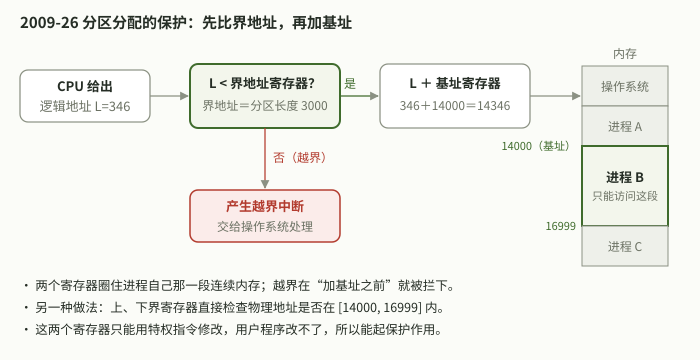
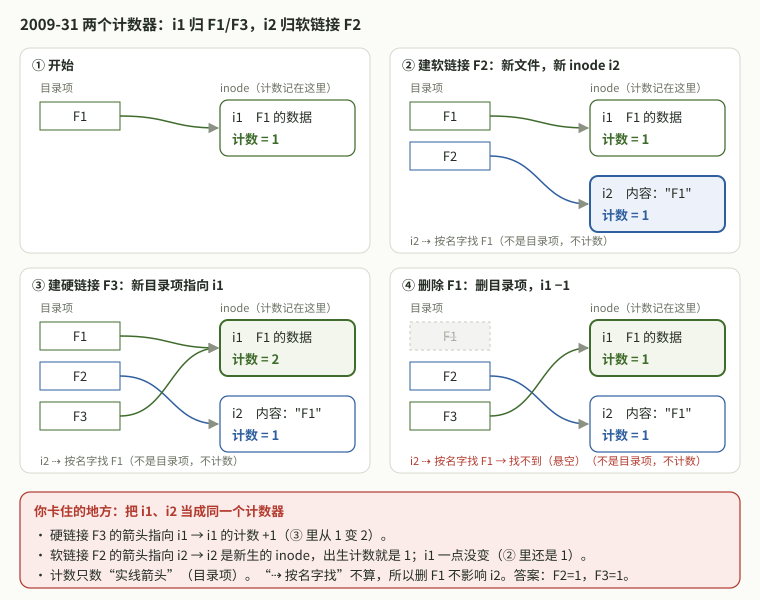

# 2026-10-09 操作系统｜死锁资源数、界地址保护、FCB 和两个 inode 计数

## 今天实际涉及

- 已讨论（直接要讲解，没有作答）：2009 年选择 25（打印机与死锁的最小进程数）、26（分区分配的保护措施）、30（访问控制信息放在哪）。三题不在 10-08 记录的错题里，整卷所选选项未知。26、30 还看了图解。
- 已讨论（追问三次）：2009 年选择 31（软硬链接引用计数）。10-08 整卷判错，今天没有重新作答，直接要讲解，随后追问“为什么软链接计数也是 1”，并请助手画图诊断。
- 计划，未完成：10-08 的四道重做（28、31、45、46）今天没有作答记录；10-05 的 `PV-22`、`PV-23`、`PV-24` 也没有记录。
- 25、26、30、31 的题面都是助手凭记忆整理的，未对照真题册。

## 题目状态

| 题目 | 状态 | 来源 | 卡点／错误步骤 → 更正 | 下次验证 |
|---|---|---|---|---|
| `408-2009-25` 8 台打印机、每进程最多 3 台，可能死锁的最小进程数（题面凭记忆，待核） | 已讨论 | [14:47](../../问答记录/操作系统/2026-10-09.md) | 没有作答；讲解给出 R ≥ K(m−1)+1 一定不死锁，K=4 时可能死锁 | 闭卷换数据，用公式求最小 K |
| `408-2009-26` 分区分配的主要保护措施（题面凭记忆，待核） | 已讨论 | [14:52](../../问答记录/操作系统/2026-10-09.md)、[14:54](../../问答记录/操作系统/2026-10-09.md) | 自述对这块陌生；没有作答 | 闭卷画出“先比界地址、再加基址”的流程 |
| `408-2009-30` 文件访问控制信息存放位置（题面凭记忆，待核） | 已讨论 | [14:52](../../问答记录/操作系统/2026-10-09.md)、[14:54](../../问答记录/操作系统/2026-10-09.md) | 自述对这块陌生；没有作答 | 闭卷说出 FCB／inode 里有哪些信息，FAT 存什么 |
| `408-2009-31` 软链接、硬链接后的引用计数（题面凭记忆，待核） | 作答待核实 | [15:09](../../问答记录/操作系统/2026-10-09.md)、[15:12](../../问答记录/操作系统/2026-10-09.md)、[15:14](../../问答记录/操作系统/2026-10-09.md)、[15:16](../../问答记录/操作系统/2026-10-09.md) | 把 F1 的 inode 计数和软链接自己 inode 的计数当成同一个数 → 每个 inode 各有一个计数，只数指向它的目录项；答案 B（1，1） | 闭卷画出每个目录项指向哪个 inode，再算计数 |

- `408-2009-31` 今天只有讲解，没有新作答，状态由 10-08 的整卷作答推出。`408-2009-28`、`408-2009-45`、`408-2009-46` 今天没有记录，沿用 10-08（作答待核实）。10-05 的旧题沿用 10-05。

## 作答记录

| 编号 | 作答方式 | 作答内容／附件 | 核对结果 | 核对依据 | 来源 |
|---|---|---|---|---|---|

- 今天没有作答，不写行。25、26、30 在 10-08 整卷中做过，但所选选项没有转录，不能补记作答。

## 知识点与适用条件

- **同类资源一定不死锁的条件**：K 个进程，每个最多需要 m 个同类资源，资源总数 R。R ≥ K(m−1)+1 时一定不会死锁：最坏情况每人拿 m−1 个，只要还剩 1 个，就有人能拿满运行完再释放。问“可能死锁的最小 K”，取使该式不成立的最小 K。前提：资源同类、每个进程的最大需求都是 m。
- **分区分配的保护**：重定位（基址）寄存器 + 界地址（限长）寄存器。逻辑地址先和界地址比较，越界产生中断交给操作系统；不越界才加基址得到物理地址。两个寄存器只能用特权指令修改。也可以用上、下界寄存器检查物理地址。“代码保护”“数据保护”“栈保护”只说了保护什么，没说用什么机制。
- **访问控制信息放在 FCB**：FCB 存文件名、类型、物理位置、大小、存取控制信息、时间等；Unix 把文件名以外的信息放进 inode，权限即 rwx 位。open 时先查目录、读 FCB、按存取控制信息检查权限。FAT 只记录盘块之间的链接。
- **两个 inode 两个计数**：硬链接是新目录项指向同一个 inode，该 inode 计数 +1；软链接是新文件，有自己的 inode（新建时计数就是 1），内容是路径，访问时按名字再找原文件，不改变原 inode 的计数。删除一个名字就是删一个目录项，该 inode 计数 −1，为 0 才回收 inode 和数据。

## 我的卡点与纠正

- `408-2009-31`：15:12 问“这个为什么也是 1”、15:14 问“软链接不加，为什么创立时也加 1” → 把 i1（F1 的 inode）和 i2（软链接 F2 自己的 inode）当成同一个计数器（15:16 助手诊断，属推断） → 先问“这个目录项指向哪个 inode”，计数记在那个 inode 上。“软链接不加”指不加原文件的计数；“软链接计数是 1”是它自己的计数。
- `408-2009-26`、`408-2009-30`：用户自述“有点陌生”，是知识点没见过，不是计算错误；没有作答，未复核。

## 闭卷自测

### 自测：迁移｜换一组数，可能死锁的最小进程数是多少？

**题干**：系统有 10 台同类磁带机，由 K 个进程竞争使用，每个进程最多需要 4 台。(1) 系统可能发生死锁的 K 的最小值是多少？给出一种死锁时的分配情况。(2) 若改为 5 个进程、每个最多需要 3 台，至少要多少台才能保证不会死锁？本题改编自 `408-2009-25`，不是原真题。

**参考要点**：
- (1) 一定不死锁需 10 ≥ 3K + 1，即 K ≤ 3。K = 4 时 3 × 4 = 12 > 10，可能死锁：例如四个进程各持 3、3、2、2 台，10 台全分完，每个都还差，谁也运行不完。所以最小 K = 4。
- (2) R ≥ 5 × (3 − 1) + 1 = 11 台。
- 易错：用 K × m 去比，或者忘了“+1”。

### 自测：界地址寄存器为 3000 时，逻辑地址 2999 和 3000 分别会怎样？

**题干**：采用分区分配、动态重定位的系统中，某进程的重定位（基址）寄存器为 14000，界地址（限长）寄存器为 3000，表示分区长度。CPU 依次给出逻辑地址 2999 和 3000，分别会发生什么？如果是物理地址，各是多少？这两个寄存器能不能由用户程序修改？题源：`408-2009-26` 的保护机制，数字是自拟的。

**参考要点**：
- 合法逻辑地址是 0～2999。2999 < 3000，不越界，物理地址 = 14000 + 2999 = 16999。
- 3000 不小于界地址，越界，产生中断（越界异常）交给操作系统处理，不访存。
- 顺序是先比较界地址、再加基址；比较的是逻辑地址。
- 两个寄存器只能在内核态用特权指令修改，进程切换时由操作系统装入。

### 自测：迁移｜给软链接再建一个硬链接，然后删掉原文件

**题干**：文件 F1 的引用计数为 1。依次执行：建立 F1 的符号链接（软链接）F2；建立 F2 的硬链接 F4；删除 F1。问：(1) F2 和 F4 的引用计数各是多少？(2) F1 原来的 inode 和数据还在吗？(3) 通过 F4 读文件会得到什么？本题改编自 `408-2009-31`，不是原真题。

**参考要点**：
- F2 有自己的 inode i2，内容是路径 "F1"。F4 是 F2 的硬链接，指向 i2，所以 i2 计数 2；F2、F4 的计数都是 2。
- F1 的 inode i1 只有 F1 一个目录项指向它，删 F1 后计数减为 0，inode 和数据被回收。
- 通过 F4 读，读到的是 i2 里的路径 "F1"，再按名字找 F1，找不到，访问失败（悬空链接）。
- 判断方法：每个目录项看它指向哪个 inode，计数记在那个 inode 上。

### 自测：迁移｜同一文件的两个硬链接名，权限能不能不同？

**题干**：在 Unix 类文件系统中，目录项只含文件名和 inode 号，其余属性（含 rwx 存取控制信息）在 inode 里。文件 A 有一个硬链接 B。(1) 能不能让 A 只读、B 可写？(2) 执行 open("B") 检查权限时，读的是哪里的存取控制信息？(3) FAT 表里能不能记权限？题源：`408-2009-30` 的知识点，本题是迁移问法。

**参考要点**：
- (1) 不能。A、B 两个目录项指向同一个 inode，权限只有一份，改了一个名字的权限，另一个名字看到的也变了。
- (2) open 先在目录里按名字 B 找到 inode 号，读入 inode（即 FCB 中除文件名外的部分），按其中的存取控制信息检查。
- (3) FAT 只记录盘块之间的链接（下一块是哪块），不存文件属性。
- 对比：软链接有自己的 inode，但访问时最终按目标文件的权限检查。

## 下次先做

- [ ] `408-2009-31`：盖住今天的讲解，闭卷做 10-08 18:57 的重做题，先画出 F1、F2、F3 各指向哪个 inode，再选。
- [ ] `408-2009-45`：闭卷重写三个进程（10-08 起仍未做），每个信号量写一句含义，作答全文贴进当天问答。
- [ ] `408-2009-46`：闭卷重算第 (1) 问，按“查 TLB → 查页表 → 缺页 → 访存”逐项加时间。

## 来源与边界

- [当天操作系统问答](../../问答记录/操作系统/2026-10-09.md)：14:47、14:52、14:54、15:09、15:12、15:14、15:16。
- 四题的答案和讲解都由当天助手给出，题面待对照真题册。“混淆两个计数器”是助手根据追问做的推断。
- 自测中的 14000、3000、10 台磁带机等数字是自拟的，不是原题数据。
