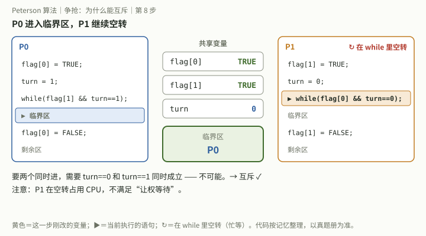

# 2026-10-10 操作系统｜链接与装入、2010 真题整卷、Peterson 算法

## 今天实际涉及

- 已讨论（上午，没有作答）：零壹考研课程视频里的一道选择题“动态链接相比静态链接的优点”，看了分步动画，又追问三种链接、三种装入的区别，并让助手串联相关知识点、完善“从源程序到运行”总图。用户自述：三种链接、三种装入“很模糊”。
- 已作答（整卷，独立）：2010 年 408 真题。操作系统选择判错 26、27、29、30、32；大题 45 估 3/7，46 估 2/8。用户自己对答案并用红笔订正；作答由批改助手看原图后转述，原图 10-13 起公开在[考试记录](../../考试记录/2026-10-10_408_2010真题.md)。
- 已讨论（晚上）：选择 26（降低优先级的时机）、27（Peterson 算法）各讲了一遍，27 还看了分步动画。两题都没有重新作答。
- 计划，未完成：2009 年四道重做题（28、31、45、46）仍没有作答记录；各错题小节的“检验”迁移题也都未作答。
- 2010 年 26、27 的题面是助手凭记忆整理的；45、46 题意凭记忆整理，未对照真题册。

## 题目状态

| 题目 | 状态 | 来源 | 卡点／错误步骤 → 更正 | 下次验证 |
|---|---|---|---|---|
| `零壹考研视频-内存管理-动态链接优点` 动态链接相比静态链接的优点（截图逐字转录，无题号和官方答案） | 已讨论 | [08:13](../../问答记录/操作系统/2026-10-10.md)、[08:14](../../问答记录/操作系统/2026-10-10.md)、[08:18](../../问答记录/操作系统/2026-10-10.md)、[08:23](../../问答记录/操作系统/2026-10-10.md) | 没有作答；三种链接、三种装入自述模糊 → 链接管“库何时接入”，装入管“地址何时变成物理地址” | 闭卷说出三种链接、三种装入各自“什么时候做” |
| `408-2010-26` 降低进程优先级的合理时机（题面凭记忆，待核） | 作答待核实 | [17:52](../../问答记录/操作系统/2026-10-10.md)、[19:57](../../问答记录/操作系统/2026-10-10.md) | 选 C“长期处于就绪队列” → 应选 A 时间片用完；长期等待应升优先级（老化） | 闭卷判断四种情况各是升、降还是不变 |
| `408-2010-27` Peterson 算法能否互斥、会否饥饿（题面凭记忆，待核） | 作答待核实 | [17:52](../../问答记录/操作系统/2026-10-10.md)、[20:04](../../问答记录/操作系统/2026-10-10.md)、[20:09](../../问答记录/操作系统/2026-10-10.md) | 选 A“不能互斥、会饥饿” → 应选 D；两者同时进入需要 turn 同时为 0 和 1 | 闭卷写出 Peterson 代码，用 turn 论证互斥和有限等待 |
| `408-2010-29` 二级页表的页目录项数（原题干未录入） | 作答待核实 | [17:52](../../问答记录/操作系统/2026-10-10.md) | 选 D → 应选 B：每页放 2¹⁰/2 = 2⁹ 个页表项，页目录 2¹⁶/2⁹ = 128 项 | 先写“一页放几项”，闭卷做 17:52 检验 (a) |
| `408-2010-30` 索引结点能表示的最大文件（原题干未录入） | 作答待核实 | [17:52](../../问答记录/操作系统/2026-10-10.md) | 选 D → 应选 C：每块放 256/4 = 64 个地址，(4 + 2×64 + 64²) × 256B = 1057KB | 先写“一块放几个地址”，闭卷做 17:52 检验 (b) |
| `408-2010-32` 键盘输入最先由谁取得（原题干未录入） | 作答待核实 | [17:52](../../问答记录/操作系统/2026-10-10.md) | 选 C → 应选 B，先由中断处理程序取得 | 闭卷写出键盘输入从中断到用户进程的层次 |
| `408-2010-45` 位示图、CSCAN 访问时间、Flash 调度 | 作答待核实 | [17:52](../../问答记录/操作系统/2026-10-10.md) | (2) 漏了旋转延迟，把“转一圈”和“读一个扇区”的时间混了 → 170ms + 20ms + 0.4ms = 190.4ms；(3) 写 LRU 后划掉 → FCFS | 时间题先写“寻道 + 旋转 + 传输”再算 |
| `408-2010-46` FIFO 与 CLOCK 置换后的物理地址 | 作答待核实 | [17:52](../../问答记录/操作系统/2026-10-10.md) | (2) 换了页 2 → FIFO 换装入最早的 0 号页，1FCAH；(3) 没有从指针处扫 → 访问位全 1 时转一圈回到 2 号页框，0BCAH | 闭卷在纸上画环，逐格清访问位 |

- `408-2009-28`、`408-2009-31`、`408-2009-45`、`408-2009-46` 今天没有记录，沿用 10-09；10-09 讨论过的 25、26、30 沿用“已讨论”；10-05 的旧题沿用 10-05。

## 作答记录

| 编号 | 作答方式 | 作答内容／附件 | 核对结果 | 核对依据 | 来源 |
|---|---|---|---|---|---|
| `408-2010-26` | 独立 | 整卷原图，见[考试记录](../../考试记录/2026-10-10_408_2010真题.md)，选 C | 错误 | 仅旧助手判断 | [17:52](../../问答记录/操作系统/2026-10-10.md) |
| `408-2010-27` | 独立 | 整卷原图，见[考试记录](../../考试记录/2026-10-10_408_2010真题.md)，选 A | 错误 | 仅旧助手判断 | [17:52](../../问答记录/操作系统/2026-10-10.md) |
| `408-2010-29` | 独立 | 整卷原图，见[考试记录](../../考试记录/2026-10-10_408_2010真题.md)，选 D | 错误 | 仅旧助手判断 | [17:52](../../问答记录/操作系统/2026-10-10.md) |
| `408-2010-30` | 独立 | 整卷原图，见[考试记录](../../考试记录/2026-10-10_408_2010真题.md)，选 D | 错误 | 仅旧助手判断 | [17:52](../../问答记录/操作系统/2026-10-10.md) |
| `408-2010-32` | 独立 | 整卷原图，见[考试记录](../../考试记录/2026-10-10_408_2010真题.md)，选 C | 错误 | 仅旧助手判断 | [17:52](../../问答记录/操作系统/2026-10-10.md) |
| `408-2010-45` | 独立 | 整卷原图，见[考试记录](../../考试记录/2026-10-10_408_2010真题.md)；转写见 17:52 小节「作答」 | 部分正确 | 仅旧助手判断 | [17:52](../../问答记录/操作系统/2026-10-10.md) |
| `408-2010-46` | 独立 | 整卷原图，见[考试记录](../../考试记录/2026-10-10_408_2010真题.md)；转写见 17:52 小节「作答」 | 部分正确 | 仅旧助手判断 | [17:52](../../问答记录/操作系统/2026-10-10.md) |

- 选择题对错按用户红笔订正；大题由批改助手凭 2010 年评分标准的记忆估分，未对答案册逐条核。19:57、20:04 的讲解不是新作答。

## 知识点与适用条件

- **链接与装入是两件事**：链接管“目标模块和库什么时候拼成一个整体”——静态链接（运行前拼好，每个程序各带一份库）、装入时动态链接（装入时边装边拼）、运行时动态链接（执行到调用才找库、装入、链接）。装入管“逻辑地址什么时候换成物理地址”——绝对装入（编译时定死，只适合单道）、可重定位装入（装入时一次改好，运行中不能移动）、动态运行时装入（每次访问时加重定位寄存器，可对换、紧凑）。“动态链接”的动态指库何时接入；“动态重定位”的动态指地址何时转换。
- **动态链接的优点**：可执行文件不各带一份库，省外存；内存里只放一份共享库，各进程页表项指向同一批页框，省内存。它不加快地址转换，首次调用还要查找和链接，是用时间换空间。共享的代码必须是可重入代码。
- **优先级调整方向**：占 CPU 多（时间片用完）→ 降；被亏待（长期在就绪队列）→ 升（老化，防饥饿）；刚完成 I/O → 一般升，让设备和 CPU 并行；刚被调度上 CPU → 不调整。
- **Peterson 算法**：flag 表示意愿，turn 表示谦让。互斥：两者同时在临界区要求两个 while 条件都为假，flag 都为 TRUE 时只能靠 turn，而 turn 不能同时为 0 和 1。有限等待：退出者若再申请，必须先把 turn 让给对方。空闲让进：对方 flag 为 FALSE 时直接进入。缺点：while 忙等，不满足让权等待。对比：单标志法违反空闲让进；双标志先检查不能互斥；双标志后检查能互斥但可能都进不去。
- **“一块能放几项”**：页目录项数 = 页数 ÷ 每页能放的页表项数；索引结点最大文件 = 能指向的数据块总数 × 块大小，每级间接都要先算“一块放几个地址”。
- **磁盘访问时间**：寻道时间 + 平均旋转延迟（转半圈）+ 传输时间（转一圈 ÷ 每道扇区数）。Flash 没有寻道和旋转，用 FCFS。LRU 是页面置换算法，不是磁盘调度算法。
- **FIFO 与 CLOCK**：FIFO 只看装入时刻，换最早的。CLOCK 从指针所在页框开始扫，访问位为 1 就清 0 跳过，遇到第一个为 0 的换出；全为 1 时转一圈回到起点把它换出。物理地址 = 页框号拼上页内偏移。

## 我的卡点与纠正

- 上午：三种链接、三种装入“很模糊” → 两组概念都带“动态”二字，容易混 → 按“什么时候做”区分，见知识点第一条和总图。
- `408-2010-26`：选“长期处于就绪队列” → 把长期等待当成降优先级的理由（助手根据所选选项推断） → 等待是补偿（升）的理由。
- `408-2010-27`：选“不能互斥、会饥饿” → 没认出 Peterson 结构，可能和双标志先检查混了（助手推断） → 用“turn 不能同时取两个值”验证互斥。
- `408-2010-29`、`408-2010-30`：两道计算都卡在“一块（一页）能放几个项”这一步。
- `408-2010-45`：漏旋转延迟。和 `408-2009-46` 漏访存是同一类：时间题没有按流程逐项列。
- `408-2010-46`：FIFO 没选装入最早的页；CLOCK 没从指针处开始扫，也不清楚全 1 时会回到起点。估 2/8，是这几天得分最低的大题。

## 闭卷自测

### 自测：动态链接和动态重定位分别解决什么问题？

**题干**：判断下面两种需求各要靠哪一种机制（从“静态链接、装入时动态链接、运行时动态链接、绝对装入、可重定位装入、动态运行时装入”中选），并说明理由：(1) 一个进程运行中被换出，再换入时放到了另一段内存，程序仍能正确运行；(2) 十个程序都调用同一个函数库，希望磁盘和内存里各只有一份库。另回答：动态链接能不能加快地址转换？题源：`零壹考研视频-内存管理-动态链接优点` 的串联追问，本题是迁移问法。

**参考要点**：
- (1) 动态运行时装入（动态重定位）：内存里保持逻辑地址，每次访问时加重定位寄存器；换到新位置只需改寄存器。可重定位装入在装入时一次改好地址，运行中不能移动。
- (2) 动态链接（装入时或运行时）：可执行文件只记录调用的库，库在磁盘和内存都只有一份，各进程页表项指向同一批页框。
- 不能。地址转换靠 MMU 查页表、TLB，与链接方式无关；运行时动态链接首次调用还更慢。


### 自测：迁移｜把 Peterson 算法的两句对调，还能互斥吗？

**题干**：两个进程共享 `flag[2]`（初值都为 FALSE）和 `turn`。把 Peterson 算法进入区的两句顺序对调，变成先写 turn、再写 flag：

```c
P0: turn = 1; flag[0] = TRUE;        P1: turn = 0; flag[1] = TRUE;
    while (flag[1] && turn == 1);        while (flag[0] && turn == 0);
    临界区;                               临界区;
    flag[0] = FALSE;                     flag[1] = FALSE;
```

这样还能保证互斥吗？能的话说明理由，不能的话给出一个两者同时进入临界区的执行顺序。本题改编自 `408-2010-27`，不是原真题。

**参考要点**：
- 不能保证互斥。反例：P0 执行 turn = 1；P1 执行 turn = 0；P1 执行 flag[1] = TRUE，检查 flag[0] 为 FALSE，进入临界区；P0 执行 flag[0] = TRUE，检查 turn == 1 为假（turn 已是 0），也进入。
- 原算法的关键是先表明意愿（flag = TRUE）再谦让（turn = 对方）：最后写 turn 的一方必然看到对方的 flag 已为 TRUE，从而等待。对调后谦让发生在表明意愿之前，对方看不到你的意愿。



### 自测：迁移｜先算“一块能放几项”：页目录项数和最大文件

**题干**：(a) 页大小 4KB，页表项 4B，进程逻辑地址空间共 2²⁰ 页，采用二级页表，页目录有多少项？(b) 某文件系统的索引结点有 10 个直接地址项、1 个一级间接地址项、1 个二级间接地址项，磁盘块 1KB，每个地址项 4B，单个文件最大多大？本题是 10-10 17:52 小节的检验题，改编自 `408-2010-29`、`408-2010-30`，不是原真题。

**参考要点**：
- (a) 一页放 4KB ÷ 4B = 2¹⁰ 个页表项；页目录项数 = 2²⁰ ÷ 2¹⁰ = 2¹⁰ = 1024 项。
- (b) 一块放 1KB ÷ 4B = 256 个地址。可指向的数据块：10 + 256 + 256² = 65802 块；最大文件 65802 × 1KB = 65802KB。
- 两题第一步都是“一块（一页）放几个项”，再一层层乘。

### 自测：这四种情况，进程优先级该升、该降还是不变？

**题干**：在采用动态优先级（如多级反馈队列）的系统中，下列四种情况分别应提高、降低还是不调整进程的优先级？为什么？(1) 进程的时间片用完；(2) 进程刚完成 I/O，进入就绪队列；(3) 进程长期处于就绪队列中；(4) 进程从就绪态转为运行态。题源：`408-2010-26` 的四个选项，题面凭记忆整理，待对照真题册。

**参考要点**：
- (1) 降低：用完时间片说明是 CPU 型，降级让别人运行；多级反馈队列中时间片用完就降到下一级。
- (2) 一般提高：I/O 型进程很快又会去做 I/O，让它先跑，设备和 CPU 能并行。
- (3) 提高：老化，防止饥饿。
- (4) 不调整：只是被调度上 CPU，没有理由。
- 判断标准：“占 CPU 多”就降，“被亏待”就升。

### 自测：迁移｜访问位不全为 1 时，CLOCK 换出哪一页？

**题干**：页大小 1KB，进程分到 4 个页框；页 0、1、2、3 分别在页框 7、4、2、9。CLOCK 算法按页框号 2 → 4 → 7 → 9 → 2 循环扫描，指针当前指向 2 号页框。各页框的访问位：2 号为 1，4 号为 1，7 号为 1，9 号为 0。此时访问逻辑地址 17CAH，发生缺页。换出哪一页？17CAH 的物理地址是多少？本题改编自 `408-2010-46`（原题访问位全为 1），不是原真题。

**参考要点**：
- 17CAH = 0001 0111 1100 1010，页内偏移是低 10 位 3CAH，页号是 5，不在内存。
- 从 2 号页框开始：2 号访问位 1 → 清 0；4 号 1 → 清 0；7 号 1 → 清 0；9 号为 0 → 换出 9 号页框里的页 3。
- 物理地址 = 9 × 1KB + 3CAH = 2400H + 3CAH = 27CAH。
- 对比原题：访问位全为 1 时转一圈回到 2 号页框，得 0BCAH。

[地址转换演示台](../../演示/操作系统/地址转换.html)

## 下次先做

- [ ] `408-2010-46`：闭卷重做 (2)(3)，在纸上画页框环，标出指针和访问位，逐格清 0；作答全文或照片贴进当天问答。
- [ ] `408-2010-30`：闭卷重算，第一行先写“一块能放 256/4 = 64 个地址”，再逐级乘；`408-2010-29` 同样做法。
- [ ] `408-2009-45`：闭卷重写三个进程（10-08 起仍未做），每个信号量写一句含义。

## 来源与边界

- [当天操作系统问答](../../问答记录/操作系统/2026-10-10.md)：08:13、08:14、08:18、08:23、17:52（三节）、19:57、20:04、20:09。
- 作答原图在[考试记录](../../考试记录/2026-10-10_408_2010真题.md)；本复盘没有重新看图判卷。零壹考研截图未公开存档，也没有官方答案，选 C 是当天助手的判断。
- 分步动画只在对话里，仓库存的是关键帧图。2010-45 的磁盘调度可以用[磁盘调度轨迹](../../演示/操作系统/磁盘调度.html)演示页逐站走一遍。
- 自测里的 CLOCK 访问位和扫描顺序是自拟条件，不是原题数据。
