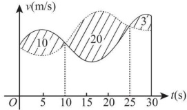

# 2017 年全国硕士研究生招生考试数学二真题

> 题面校对版 · 23 题 · 满分 150 分 · 考试时间 180 分钟。
> 仅含题目，不含答案解析。来源、校对范围与勘误见[说明](../README.md)和[核对记录](../audit/questions.json)。

## 一、选择题

### 第 1 题（4 分）

若函数  $f(x)=\begin{cases}\frac{1-\cos\sqrt{x}}{ax},&x>0,\\b,&x\leq0\end{cases}$，在 x=0 处连续，则（）

A. $ab=\frac{1}{2}$.

B. $ab=-\frac{1}{2}$.

C. $ab=0$.

D. $ab=2$.

<!-- 上游扫描件页码：162；逐题来源与哈希见 audit/questions.json。 -->

### 第 2 题（4 分）

设二阶可导函数  $f(x)$ 满足  $f(1) = f(-1) = 1$,  $f(0) = -1$ 且  $f''(x) > 0$, 则 ( )

A. $\int_{-1}^{1} f(x) \, dx > 0.$

B. $\int_{-1}^{1} f(x) \, dx < 0.$

C. $\int_{-1}^{0} f(x) \, dx > \int_{0}^{1} f(x) \, dx.$

D. $\int_{-1}^{0} f(x) \, dx < \int_{0}^{1} f(x) \, dx.$

<!-- 上游扫描件页码：163；逐题来源与哈希见 audit/questions.json。 -->

### 第 3 题（4 分）

设数列  $\{x_n\}$ 收敛，则（）

A. 当  $\lim_{n\to\infty}\sin x_n=0$ 时， $\lim_{n\to\infty}x_n=0$.

B. 当  $\lim_{n\to\infty}(x_n+\sqrt{|x_n|})=0$ 时， $\lim_{n\to\infty}x_n=0$.

C. 当  $\lim_{n\to\infty}(x_n+x_n^2)=0$ 时， $\lim_{n\to\infty}x_n=0$.

D. 当  $\lim_{n\to\infty}(x_n+\sin x_n)=0$ 时， $\lim_{n\to\infty}x_n=0$.

<!-- 上游扫描件页码：164；逐题来源与哈希见 audit/questions.json。 -->

### 第 4 题（4 分）

微分方程  $y'' - 4y' + 8y = e^{2x}(1 + \cos 2x)$ 的特解可设为  $y^* = (\quad)$

A. $Ae^{2x} + e^{2x}(B\cos 2x + C\sin 2x)$.

B. $Axe^{2x} + e^{2x}(B\cos 2x + C\sin 2x)$.

C. $Ae^{2x} + xe^{2x}(B\cos 2x + C\sin 2x)$.

D. $Axe^{2x} + xe^{2x}(B\cos 2x + C\sin 2x)$.

<!-- 上游扫描件页码：165；逐题来源与哈希见 audit/questions.json。 -->

### 第 5 题（4 分）

设  $f(x,y)$ 具有一阶偏导数，且对任意的  $(x,y)$，都有  $\frac{\partial f(x,y)}{\partial x} > 0, \frac{\partial f(x,y)}{\partial y} < 0$，则 ( )

A. $f(0,0)>f(1,1).$

B. $f(0,0)<f(1,1).$

C. $f(0,1)>f(1,0).$

D. $f(0,1)<f(1,0).$

<!-- 上游扫描件页码：166；逐题来源与哈希见 audit/questions.json。 -->

### 第 6 题（4 分）

甲,乙两人赛跑,计时开始时,甲在乙前方 10(单位:m)处,图中,实线表示甲的速度曲线  $v = v_1(t)$(单位:m/s), 虚线表示乙的速度曲线  $v = v_2(t)$, 三块阴影部分面积的数值依次为 10,20,3. 计时开始后乙追上甲的时刻记为  $t_0$(单位:s), 则 ( )

A. $t_0 = 10$.

B. $15 < t_0 < 20$.

C. $t_0 = 25$.

D. $t_0 > 25$.

<!-- 上游扫描件页码：167；逐题来源与哈希见 audit/questions.json。 -->

### 第 7 题（4 分）

设 A 为 3 阶矩阵,  $P = (\alpha_{1}, \alpha_{2}, \alpha_{3})$ 为可逆矩阵, 使得  $P^{-1} A P = \begin{pmatrix} 0 & 0 & 0 \\ 0 & 1 & 0 \\ 0 & 0 & 2 \end{pmatrix}$, 则  $A(\alpha_{1} + \alpha_{2} + \alpha_{3}) = (\quad)$

A. $\alpha_{1} + \alpha_{2}$.

B. $\alpha_{2} + 2\alpha_{3}$.

C. $\alpha_{2} + \alpha_{3}$.

D. $\alpha_{1} + 2\alpha_{2}$.

<!-- 上游扫描件页码：168；逐题来源与哈希见 audit/questions.json。 -->

### 第 8 题（4 分）

已知矩阵  $A = \begin{pmatrix} 2 & 0 & 0 \\ 0 & 2 & 1 \\ 0 & 0 & 1 \end{pmatrix}$,  $B = \begin{pmatrix} 2 & 1 & 0 \\ 0 & 2 & 0 \\ 0 & 0 & 1 \end{pmatrix}$,  $C = \begin{pmatrix} 1 & 0 & 0 \\ 0 & 2 & 0 \\ 0 & 0 & 2 \end{pmatrix}$，则（）

A. A 与 C 相似, B 与 C 相似.

B. A 与 C 相似, B 与 C 不相似.

C. A 与 C 不相似, B 与 C 相似.

D. A 与 C 不相似, B 与 C 不相似.

<!-- 上游扫描件页码：169；逐题来源与哈希见 audit/questions.json。 -->

## 二、填空题

### 第 9 题（4 分）

曲线  $y = x(1 + \arcsin\frac{2}{x})$ 的斜渐近线方程为 ________.

<!-- 上游扫描件页码：170；逐题来源与哈希见 audit/questions.json。 -->

### 第 10 题（4 分）

设函数  $y = y(x)$ 由参数方程  $\begin{cases} x = t + e^t, \\ y = \sin t \end{cases}$ 确定，则  $\left. \frac{d^2 y}{dx^2} \right|_{t=0} =$ ________.

<!-- 上游扫描件页码：171；逐题来源与哈希见 audit/questions.json。 -->

### 第 11 题（4 分）

$\int_{0}^{+\infty}\frac{\ln(1+x)}{(1+x)^2}dx=$________.

<!-- 上游扫描件页码：172；逐题来源与哈希见 audit/questions.json。 -->

### 第 12 题（4 分）

设函数  $f(x,y)$ 具有一阶连续偏导数，且  $df(x,y)=ye^y \mathrm{d}x + x(1+y)e^y \mathrm{d}y$,  $f(0,0)=0$，则  $f(x,y)=$ ________.

<!-- 上游扫描件页码：173；逐题来源与哈希见 audit/questions.json。 -->

### 第 13 题（4 分）

$\int_{0}^{1}dy\int_{y}^{1}\frac{\tan x}{x}dx=$________.

<!-- 上游扫描件页码：174；逐题来源与哈希见 audit/questions.json。 -->

### 第 14 题（4 分）

设矩阵  $A = \begin{pmatrix} 4 & 1 & -2 \\ 1 & 2 & a \\ 3 & 1 & -1 \end{pmatrix}$ 的一个特征向量为  $\begin{pmatrix} 1 \\ 1 \\ 2 \end{pmatrix}$，则 a = ________.

<!-- 上游扫描件页码：175；逐题来源与哈希见 audit/questions.json。 -->

## 三、解答题

### 第 15 题（10 分）

求 $\lim_{x\to0^{+}}\frac{\int_{0}^{x}\sqrt{x-t}e^{t}dt}{\sqrt{x^{3}}}$.

<!-- 上游扫描件页码：176；逐题来源与哈希见 audit/questions.json。 -->

### 第 16 题（10 分）

设函数 $f(u,v)$具有2阶连续偏导数， $y=f(e^x, \cos x)$，求 $\left.\frac{dy}{dx}\right|_{x=0}, \left.\frac{d^2y}{dx^2}\right|_{x=0}$.

<!-- 上游扫描件页码：177；逐题来源与哈希见 audit/questions.json。 -->

### 第 17 题（10 分）

求 $\lim_{n\to\infty}\sum_{k=1}^{n}\frac{k}{n^{2}}\ln\left(1+\frac{k}{n}\right)$

<!-- 上游扫描件页码：178；逐题来源与哈希见 audit/questions.json。 -->

### 第 18 题（10 分）

已知函数  $y(x)$ 由方程  $x^{3}+y^{3}-3x+3y-2=0$ 确定，求  $y(x)$ 的极值.

<!-- 上游扫描件页码：179；逐题来源与哈希见 audit/questions.json。 -->

### 第 19 题（10 分）

设函数  $f(x)$ 在区间  $[0,1]$ 上具有 2 阶导数，且  $f(1) > 0, \lim_{x \to 0^{+}} \frac{f(x)}{x} < 0$. 证明：

(I) 方程  $f(x)=0$ 在区间  $(0,1)$ 内至少存在一个实根；

(II) 方程  $f(x)f''(x) + [f'(x)]^{2} = 0$ 在区间  $(0,1)$ 内至少存在两个不同实根.

<!-- 上游扫描件页码：180；逐题来源与哈希见 audit/questions.json。 -->

### 第 20 题（11 分）

已知平面区域  $D=\left\{(x,y)\mid x^{2}+y^{2}\leqslant2y\right\}$，计算二重积分  $\iint_{D}(x+1)^{2}dxdy$.

<!-- 上游扫描件页码：181；逐题来源与哈希见 audit/questions.json。 -->

### 第 21 题（11 分）

设 $y(x)$是区间 $\left(0,\frac{3}{2}\right)$内的可导函数，且 $y(1)=0$。点P是曲线 $l:y=y(x)$上的任意一点，l在点P处的切线与y轴相交于点 $(0,Y_{P})$，法线与x轴相交于点 $(X_{P},0)$，若 $X_{P}=Y_{P}$，求l上点的坐标 $(x,y)$满足的方程。

<!-- 上游扫描件页码：182；逐题来源与哈希见 audit/questions.json。 -->

### 第 22 题（11 分）

设3阶矩阵 $A=(\alpha_{1},\alpha_{2},\alpha_{3})$有3个不同的特征值，且 $\alpha_{3}=\alpha_{1}+2\alpha_{2}$

(I) 证明  $r(A)=2;$

(II) 若  $\beta = \alpha_{1} + \alpha_{2} + \alpha_{3}$，求方程组 Ax =  $\beta$ 的通解.

<!-- 上游扫描件页码：183；逐题来源与哈希见 audit/questions.json。 -->

### 第 23 题（11 分）

设二次型  $f(x_{1},x_{2},x_{3})=2x_{1}^{2}-x_{2}^{2}+ax_{3}^{2}+2x_{1}x_{2}-8x_{1}x_{3}+2x_{2}x_{3}$ 在正交变换 x=Qy 下的标准形为  $\lambda_{1}y_{1}^{2}+\lambda_{2}y_{2}^{2}$，求 a 的值及一个正交矩阵 Q.

<!-- 上游扫描件页码：184；逐题来源与哈希见 audit/questions.json。 -->
