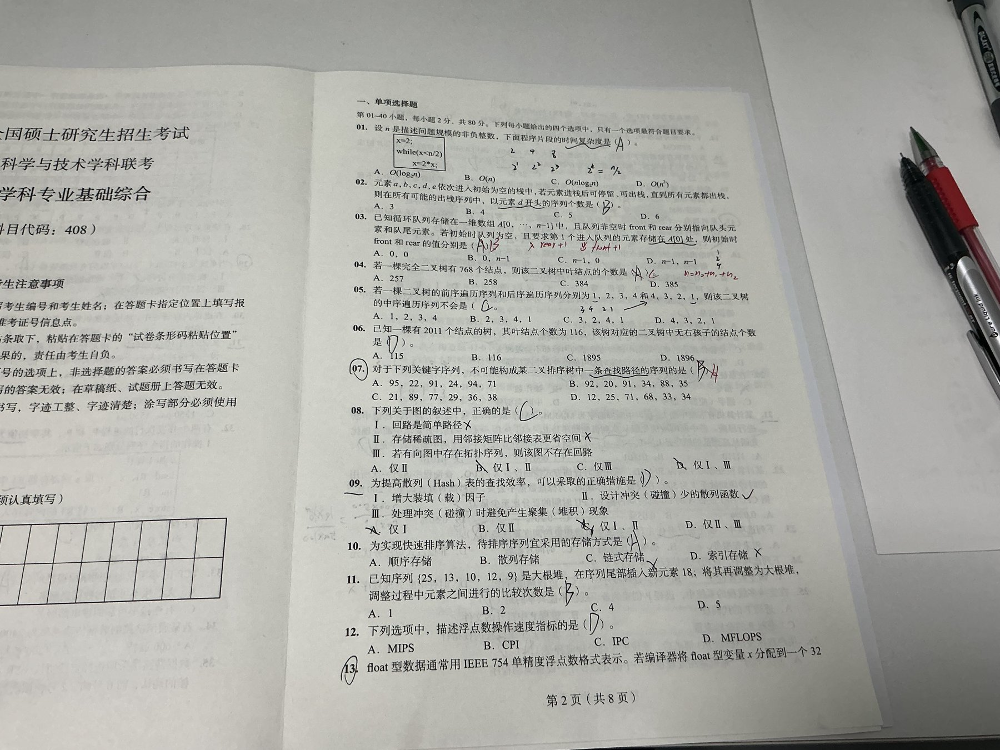
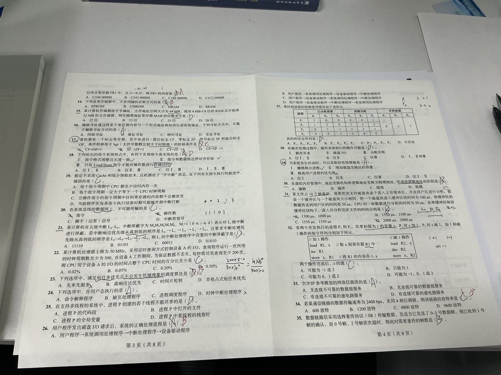
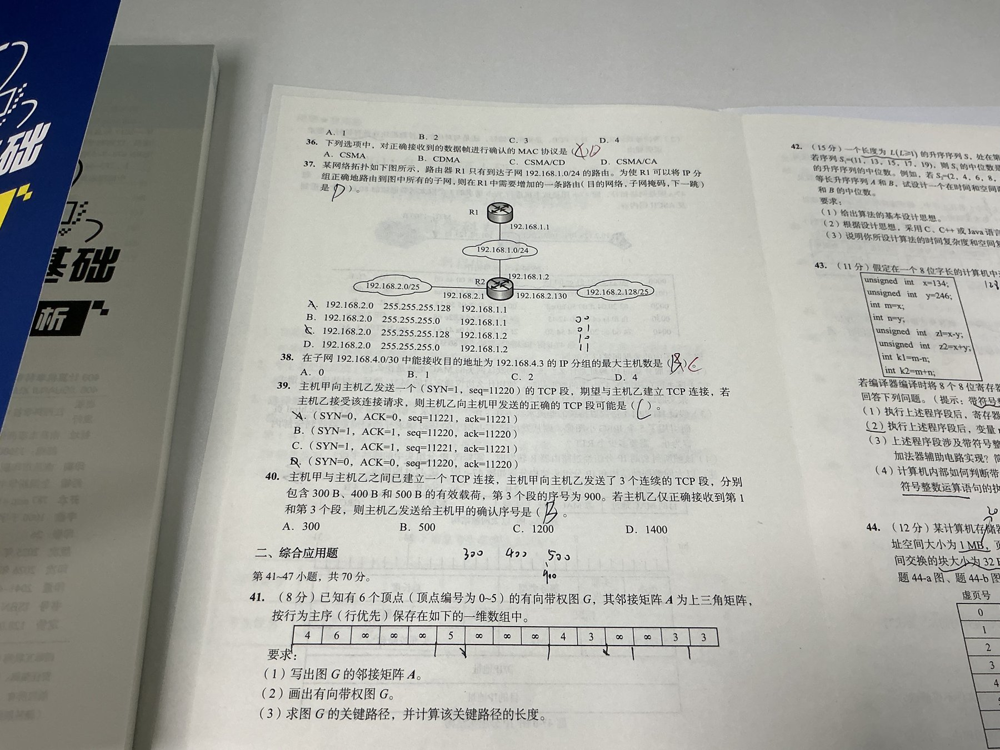
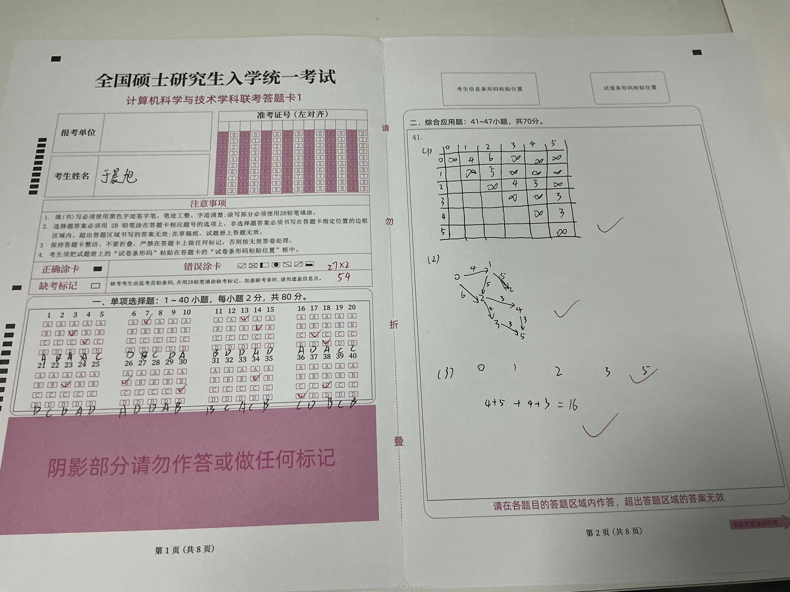
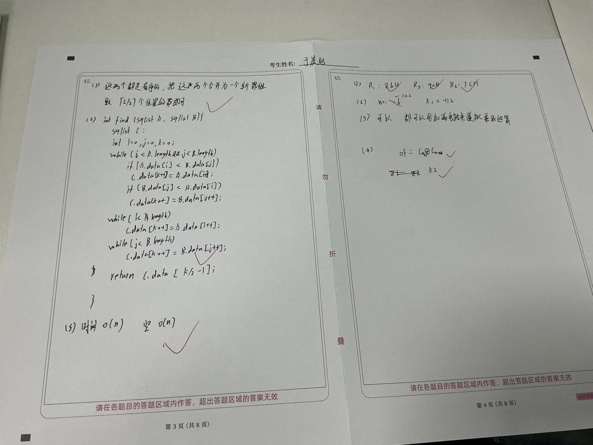
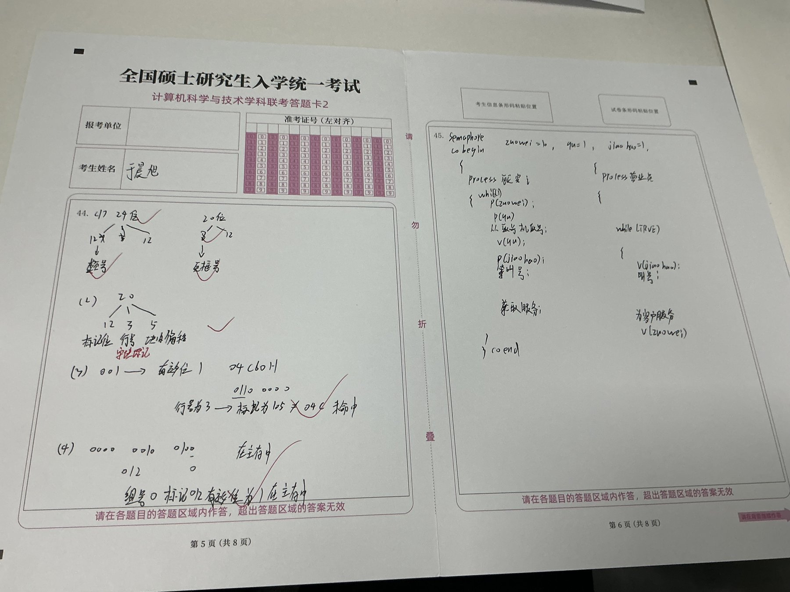
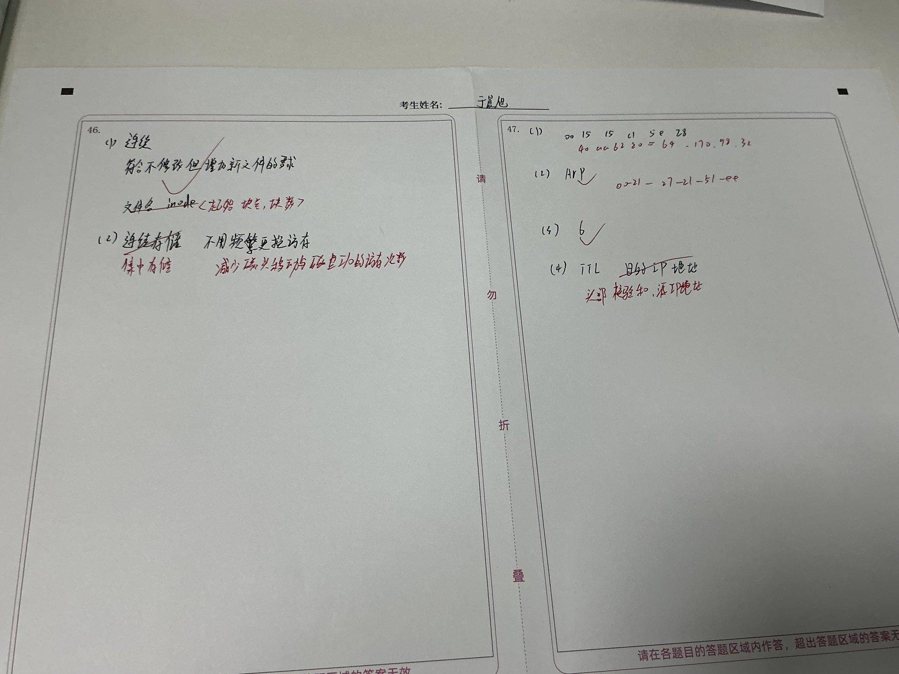

# 2026-10-16 408｜2011 真题整卷模拟（第四次，按年份顺序的第一套）

## 成绩

| 日期 | 科目 | 试卷 | 用时 | 选择 | 大题 | 总分 | 满分 |
|---|---|---|---|---|---|---|---|
| 2026-10-16 | 408 | 2011 真题 | 未记 | 54 | 50 | 104 | 150 |

- 选择：27 题对，27 × 2 = 54，按用户对答案的红笔订正统计（答题卡上写有“27×2 = 54”）。
- 大题：41、44 全对（44 的虚页号 12 位、页框号 8 位、标记 12 / 行号 3 / 块内 5、04C60H 未命中、TLB 标记 012H 命中都对）；42 用归并法，思路和复杂度对但不是最优解，代码有两处漏洞；45 同步关系缺了“营业员等顾客”；47 前两问基本没答出。大题由助手参照红笔订正和 2011 官方答案的记忆估分，单题可能有一两分出入。
- 四套走势：2009 约 95、2010 约 70、2024 约 98、2011 约 104，第一次过 100。
- 四科丢分：数据结构 13、操作系统 12、计算机组成原理 11、计算机网络 11。比 2024 平均，没有哪一科特别塌。
- 拿不准：题号画圈的是 7、13、17、29，划线的是 9、15、21、31。其中 7、13、17 做错；9、15、21、29、31 做对但不稳，记进各科 2026-10-16 问答记录。
- 作答原图按 2026-10-13 的约定公开，见下面「作答原图」；表格是助手看原图后整理的文字。

## 逐题丢分

| 题号 | 题型 | 科目 | 得分 | 满分 | 错因 | 要点 |
|---|---|---|---|---|---|---|
| 3 | 选择 | 数据结构 | 0 | 2 | 概念不清 | 入队是 rear 先加 1 再存，要让第一个元素落在 A[0]，rear 初值为 n−1、front 为 0，答案 B |
| 4 | 选择 | 数据结构 | 0 | 2 | 计算漏步 | 完全二叉树 n = 768 为偶数时 n₁ = 1，叶子 n₀ = ⌈n/2⌉ = 384，答案 C |
| 7 | 选择 | 数据结构 | 0 | 2 | 审题 | A 中 91 之后走左子树，后面都应小于 91，94 不可能，答案 A |
| 13 | 选择 | 计算机组成原理 | 0 | 2 | 计算漏步 | −8.25 = −1.00001 × 2³，阶码 3 + 127 = 1000 0010，机器数 C104 0000H，答案 A |
| 14 | 选择 | 计算机组成原理 | 0 | 2 | 概念不清 | EPROM 是随机存取的 ROM；CDROM 不是随机存取，答案 B |
| 17 | 选择 | 计算机组成原理 | 0 | 2 | 概念不清 | 无符号大于：CF = 0 且 ZF = 0，即 CF + ZF = 0，答案 C |
| 18 | 选择 | 计算机组成原理 | 0 | 2 | 概念不清 | 定长指令、按边界对齐、只有 Load/Store 访存三条都利于流水线，答案 D |
| 23 | 选择 | 操作系统 | 0 | 2 | 概念不清 | 高响应比优先既照顾短作业，等待久的长作业响应比也会升高，不会饥饿，答案 B |
| 26 | 选择 | 操作系统 | 0 | 2 | 概念不清 | 用户程序 → 系统调用处理程序 → 设备驱动程序 → 中断处理程序，答案 B |
| 30 | 选择 | 操作系统 | 0 | 2 | 概念不清 | 链接把各模块合成一个装入模块时形成完整的逻辑地址，答案 C |
| 34 | 选择 | 计算机网络 | 0 | 2 | 计算漏步 | 4 相位每码元 2 bit，波特率 = 2400 ÷ 2 = 1200，答案 B |
| 36 | 选择 | 计算机网络 | 0 | 2 | 概念不清 | 无线局域网 CSMA/CA 对正确收到的帧回 ACK，答案 D |
| 38 | 选择 | 计算机网络 | 0 | 2 | 计算漏步 | /30 的 192.168.4.3 是广播地址，子网内 .1、.2 两台主机都能收，答案 C |
| 42 | 大题 | 数据结构 | 8 | 15 | 模板没掌握 | 归并后取第 L 个，思想、复杂度 O(n)/O(n) 对；非最优解最高约 10 分；if 两个分支都用严格小于，遇相等元素死循环；剩余段写成 while (k < A.length)，应为 i |
| 43 | 大题 | 计算机组成原理 | 8 | 11 | 概念不清 | (1) 86H、90H、7CH 对；(2) m 先写 −6，应为 −122，k1 = −112 对；(3) 理由写成“加法模拟乘法”，应为“n 位加法器做模 2ⁿ 加，减法对减数求补后相加，补码与无符号共用”；(4) OF = Cn ⊕ Cn−1、k2 溢出对 |
| 45 | 大题 | 操作系统 | 4 | 8 | 同步顺序 | 座位 10、取号互斥对；叫号信号量初值应为 0；缺“顾客取号后 V(有顾客)、营业员 P(有顾客)”，营业员会在没人时也空转叫号 |
| 46 | 大题 | 操作系统 | 6 | 8 | 知识点不会 | (1) 连续分配、FCB 存起始块号和块数对；(2) 写成“连续存储”，红笔改为 FCB 集中存放，减少查目录时的磁盘 I/O |
| 47 | 大题 | 计算机网络 | 4 | 9 | 知识点不会 | (1) 主机 IP 192.168.0.8、服务器 64.170.98.32 没答出；(2) ARP 对，请求帧的目的 MAC 应为广播 FF-FF-FF-FF-FF-FF；(3) 6 个 RTT 对；(4) 只写出 TTL，还要源 IP 地址（NAT）和首部校验和 |

## 闭卷自测

以下是针对漏洞的迁移题，不是原题；数字由助手改编并算过。

### 自测：数据结构｜两个等长升序序列的中位数（2011-42 迁移）

**题干**：A、B 都是长度为 n 的升序 int 数组，可能有相等元素。写 int midOf2(int A[], int B[], int n)，返回两者合并后第 n 小的数，空间 O(1)。用 A = {2, 2, 7}、B = {2, 5, 9} 手推一遍结果。

**参考要点**：
```c
int midOf2(int A[], int B[], int n){
    int i = 0, j = 0, x;
    for (int k = 0; k < n; k++) {               // 只走到第 n 个，不用新数组
        if (j >= n || (i < n && A[i] <= B[j])) x = A[i++];   // <= 处理相等
        else x = B[j++];
    }
    return x;
}
```
手推：依次取 2(A)、2(A)、2(B)，第 3 个是 2。时间 O(n)、空间 O(1)。最优解是每次比较两段中位数、各舍一半，O(log n)，考场上写这个 O(n) 版本最稳。

### 自测：数据结构｜完全二叉树叶子数与循环队列初值（2011-03、04 迁移）

**题干**：(a) 完全二叉树有 1001 个结点，叶子几个？1000 个呢？(b) 循环队列 A[0..m−1]，front 指向队头元素、rear 指向队尾元素，入队时 rear 先加 1 再存。要让第一个元素存在 A[0]，front、rear 初值各是多少？

**参考要点**：(a) n₀ = ⌈n/2⌉：1001 个结点有 501 个叶子，1000 个有 500 个。(b) rear = m − 1（加 1 后取模得 0），front = 0。

### 自测：计算机组成原理｜float 机器数与无符号条件转移（2011-13、17 迁移）

**题干**：(a) float x = −6.75，写出 IEEE 754 机器数（十六进制）。(b) 无符号 a > b 跳转、带符号 a > b 跳转，条件分别用哪些标志？

**参考要点**：(a) 6.75 = 110.11 = 1.1011 × 2²，阶码 2 + 127 = 129 = 1000 0001；1 10000001 1011 000… 按 4 位一组 1100 0000 1101 1000 …，机器数 C0D8 0000H。(b) 无符号大于：CF = 0 且 ZF = 0；带符号大于：ZF = 0 且 SF = OF。

### 自测：操作系统｜取号服务的同步（2011-45 迁移）

**题干**：复印店有 5 把等候椅和 1 名店员。顾客进门有空椅就坐下取号，没空椅就等；店员没有顾客时休息，有顾客就叫号服务。写出信号量和两个进程。

**参考要点**：semaphore empty = 5, mutex = 1, full = 0, service = 0;
顾客：P(empty); P(mutex); 取号; V(mutex); V(full); P(service); 接受服务;
店员：while (1) { P(full); V(empty); V(service); 服务; }
关键是两条同步各成对：顾客 V(full) 告诉店员“有人”，店员 P(full) 没人就休息；店员 V(service) 叫号，顾客 P(service) 等叫号，所以 service、full 初值都是 0。

### 自测：计算机网络｜波特率、子网广播、ARP 与 NAT 改的字段（2011-34、38、47 迁移）

**题干**：(a) 16-QAM 下数据率 4800 bps，波特率多少？(b) 子网 10.0.0.8/29 中，目的地址 10.0.0.15 的分组最多几台主机能收？(c) 主机要发往外网服务器，用 ARP 找网关 MAC，ARP 请求帧的目的 MAC 是什么？(d) 分组经过做 NAT 的路由器转发出去，IP 首部要改哪些字段？

**参考要点**：(a) 16 种码元每个 4 bit，4800 ÷ 4 = 1200 波特。(b) /29 有 8 个地址 .8～.15，.15 是广播，主机 .9～.14 共 6 台都能收。(c) 广播 FF-FF-FF-FF-FF-FF；ARP 响应拿到的网关 MAC 才写进后面数据帧的目的地址。(d) 源 IP 地址（NAT 换成公网地址）、TTL 减 1、首部校验和重算。

## 下次先做

- [ ] 42 是第四次大题代码丢分：把上面 midOf2 默写两遍，重点是 `<=` 和 `j >= n` 两个边界，接着交拓扑排序 hasTopo 的默写照片。
- [ ] 计组选择丢 8 分（13、14、17、18），都是记忆点：浮点机器数按“规格化 → 阶码加 127 → 4 位一组”三步写；标志位条件转移列成一张表背。
- [ ] 45、47 两道大题共丢 9 分：先做上面两张迁移卡，同步题检查每个信号量都有一对 P、V。

## 作答原图

用户上传的原始照片（按上传顺序；已缩小尺寸并去掉照片元数据）。红笔是用户对答案后的订正。















## 来源与边界

- 来源：2026-10-16 用户在项目对话中上传的 7 张照片（试卷 3 张、答题卡 4 张，含姓名，按 2026-10-13 约定公开）。试卷 42 题以后的题面只拍到一部分，44～47 题面没有拍到。
- 选择题按用户自己对答案、红笔订正的结果记录。大题估分由助手参照红笔订正和 2011 官方答案的记忆整理，未对照答案册逐条核实。
- 47 题第 (2) 问用户红笔订正写的是 00-21-27-21-51-ee（数据帧本身的目的 MAC，即网关 MAC）；按助手对原题的记忆，问的是 ARP 请求帧的目的 MAC，应为广播地址，请对照答案册确认。
- 本文件只记录整卷成绩和丢分，不改变各科「题目状态」。
