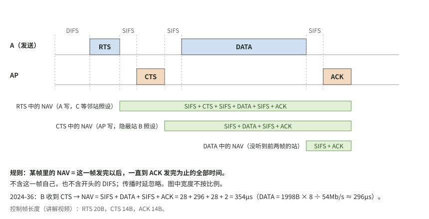
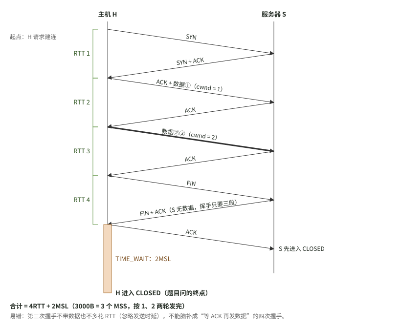
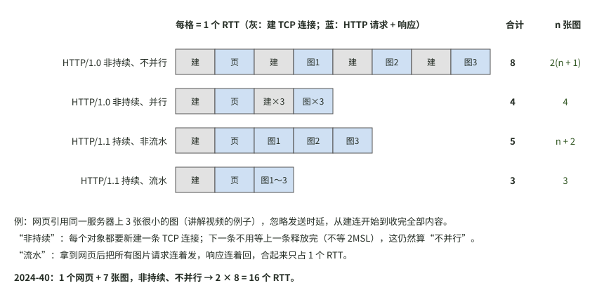

# 2026-10-15 计算机网络｜问答记录

科目：计算机网络。时间为北京时间。

## 07:57　`408-2024`　看完 2024 计网真题讲解后，哪些该记、哪些该画

**题**：用户完整听完湖科大教书匠的 B 站视频“计算机网络408考研2024年真题解析”（BV1VE411A7Ak p16），上传了术语整理版转写稿。用户问：结合自己 2024 卷的错题（选择 34、36、38、40，大题 47），讲解里哪些值得记录，哪些值得画成图？

**作答**：不是做题，未作答。错题情况见[2026-10-12 问答记录](2026-10-12.md)和[考试记录](../../考试记录/2026-10-12_408_2024真题.md)。

**答复**：

值得画的有三张，都对应算时间丢的分：
- 36 题 NAV：
- 38 题 TCP：
- 40 题 HTTP：

值得记的（只记跟错题有关、仓库里还没有的）：
- **34 题（FSK）**：看缩写认调制方式。A 是振幅（ASK，移幅键控），F 是频率（FSK，移频键控），P 是相位（PSK，移相键控）。DPSK 是差分移相键控，靠相邻码元的相位变化传信息，可以和差分曼彻斯特编码对照着记。“用两个不同频率的载波”就是 FSK。另外，FM 用于模拟信号，FSK 用于数字信号。
- **36 题（NAV）**：三个 NAV 都是从“本帧发完”算到“ACK 发完”。RTS 里的 NAV = SIFS + CTS + SIFS + DATA + SIFS + ACK，CTS 里的 NAV = SIFS + DATA + SIFS + ACK，数据帧里的 NAV = SIFS + ACK。开头的 DIFS 不算在内。控制帧长度：RTS 20B，CTS 14B，ACK 14B。
- **38 题（TCP）**：讲解给的也是 4RTT + 2MSL，和 10-12 的订正一致。补两个易错点：
  - MSS 指的是数据部分的最大长度，不含首部。
  - 第三次握手带不带数据都不多花 RTT（忽略发送时延）。“时间最多”时也不能脑补成“等 S 回 ACK 才发数据”，那等于四次握手，不存在。
  - S 没有数据要发时，挥手只有三段：FIN，FIN + ACK，ACK。终点是 H 进入 CLOSED，所以要加 H 的 2MSL。
- **40 题（HTTP）**：非持续时，每个对象都要新建连接，但下一条连接不用等上一条释放完。这仍然叫“不并行”，不要因为前一条还在挥手就当成并行。四种方式的 RTT 数见第三张图。题里给了 MSS 才考虑拥塞窗口，没给就不要凭空加。
- **47(3)（RIP 收敛）**：讲解的答案是到左侧网络 30s、到右侧网络 60s，和红笔一致。算法是：启动时第一次交换算第 0 秒，之后每过 30s 消息多传一跳，看离目的网络最远的路由器要几轮才收到。讲解说这一问很多人是“审题不严”丢的 2 分。
- **47(4)（eBGP / iBGP）**：讲解说这是 2024 年大部分人丢分的盲点，出自谢希仁第 8 版的新增内容，昨天 18:56 已经记过。补一条通告规则：从 iBGP 收到的路由可以经 eBGP 告诉别的 AS。
- **47(5)（BGP 选路）**：讲解给的完整顺序是：① 本地偏好 local preference 值高的优先；② AS 跳数少的优先；③ 热土豆，即在 AS 内离出口近的优先；④ BGP 标识符小的优先。BGP 标识符是 32 位，取路由器最大的 IP 地址，由 OPEN 报文交换。王道只写了 ②③，无策略约束的题按 ②→③ 做。讲解对 R14 的分析和王道一致：经 R11 出 AS1 只要 1 跳，经 R13 要 2 跳（中间过 R15），所以下一跳是 R11。R15 的下一跳讲解没说，留给自己分析。

做对的题（33、35、37、39）讲解里没有新内容需要补，就不记了。

**检验**（迁移题，不重做原题）：
1. 不看图，说出 DATA 帧里的 NAV 由哪几段组成。若题目改问 RTS 里的 NAV，比 CTS 里的多哪两段？
2. AS1 内有两条到 AS9 的路由：经 R1 出口的 local preference = 100，AS 路径 2 跳；经 R2 出口的 local preference = 200，AS 路径 4 跳。AS1 内的路由器选哪条？为什么不比 AS 跳数？

来源：用户 2026-10-15 07:57 上传的视频转写稿（语音识别后统一术语，稿件自述数字未逐字校对，路由器编号常把 R 识别成数字）。讲解要点由助手从稿中摘出，引用位置：36 题约 00:47～00:51，38 题约 01:02～01:12，40 题约 01:25～01:42，47 题约 01:42～02:07。BGP 四条规则以视频为准，王道 Markdown 只核到 ②③。
